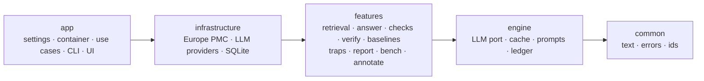

# bio-claim-check

> **Does this agent's answer hold up?** An open-source claim checker for life-science agents.

`bio-claim-check` will answer a research question from Europe PMC abstracts, then check every claim against
the paper it cites. Each claim will be labelled *supported*, *overstated* (with a reason), *unsupported* or
*not in source*. Planted traps, such as a mouse result presented as a human effect or a trial's
background sentence cited as its finding, will measure what the verifier actually catches.

**Status: pre-alpha, under active development.** Nothing here is a validated result yet.

## What it is not

- Not a fact-checker for papers: it checks whether a *claim* is faithful to the *abstract it cites*.
- Not a substitute for reading the paper: abstracts omit caveats found in the full text.

## Architecture

The package is arranged in rings that point inward. The import rules are enforced by
[import-linter](https://import-linter.readthedocs.io/), and each rule is proven to fire by a test
([ADR 0002](docs/adr/0002-rings-ports-composition-root.md)).



- **Structure in code, judgement in the LLM.** Quote location, scoring and statistics are deterministic
  and never call a model ([ADR 0003](docs/adr/0003-structure-in-code-judgement-in-llm.md)).
- Decisions are recorded in [docs/adr](docs/adr/README.md). The rules that must never break, and the
  tests that prove them, are in [docs/invariants.md](docs/invariants.md).

## Quick start (development)

Requires [uv](https://docs.astral.sh/uv/) and Python 3.13.

```bash
make sync            # locked environment
make hooks           # pre-commit: ruff, pyright, gitleaks
cp .env.example .env # fill in locally; .env is git-ignored
make verify          # lint + strict types + offline tests
uv run bio-claim-check --version
uv run bio-claim-check config   # validates settings, secrets redacted
```

With Docker:

```bash
docker compose run --rm app bio-claim-check --version
```

## Contributing

Domain experts can contribute **misreading rules without writing code**; see
[CONTRIBUTING.md](CONTRIBUTING.md). Contributors are credited in the rule packs and in releases.

## History

This project grew out of a hackathon idea about checking whether life-science agents represent their
sources faithfully. The author is building this fuller open-source version separately from any
hackathon. Rules contributed by researchers, at events or otherwise, are imported as their own credited
rule packs.

## Citation

If you use bio-claim-check, please cite it using [CITATION.cff](CITATION.cff) (GitHub: *Cite this
repository*). A DOI will be added at the 1.0 release.

## License

Code: [Apache-2.0](LICENSE). Planned datasets ship identifiers, spans and claims rather than abstract
text, because abstracts carry publisher copyright.
