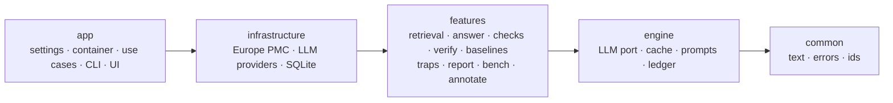

# bio-claim-check

> **Does this agent's answer hold up?** An open-source claim checker for life-science agents.

`bio-claim-check` will answer a research question from Europe PMC abstracts, then check every claim against
the paper it cites. Each claim will be labelled *supported*, *overstated* (with a reason), *contradicted* or
*not in source*. Planted traps, such as a mouse result presented as a human effect or a trial's
background sentence cited as its finding, will measure what the verifier actually catches.

**Status: pre-alpha, under active development.** Nothing here is a validated result yet.

## What it is not

- Not a fact-checker for papers: it checks whether a *claim* is faithful to the *abstract it cites*.
- Not a substitute for reading the paper: abstracts omit caveats found in the full text.

## Architecture

The package is arranged in rings that point inward. The import rules are enforced by
[import-linter](https://import-linter.readthedocs.io/), and each rule is proven to fire by a test
([ADR 0002](docs/adr/0002-rings-ports-composition-root.md)).



- The generated dependency graphs ([rings](docs/architecture/rings.dot),
  [features](docs/architecture/features.dot)) come from `make graph`, and a test fails when they are
  stale. Render them locally with `dot -Tsvg`.
- **Structure in code, judgement in the LLM.** Quote location, scoring and statistics are deterministic
  and never call a model ([ADR 0003](docs/adr/0003-structure-in-code-judgement-in-llm.md)).
- Decisions are recorded in [docs/adr](docs/adr/README.md). The rules that must never break, and the
  tests that prove them, are in [docs/invariants.md](docs/invariants.md).

## Quick start (development)

Requires [uv](https://docs.astral.sh/uv/) and Python 3.13.

```bash
make sync            # locked environment
make hooks           # pre-commit: ruff, pyright, gitleaks
cp .env.example .env # fill in locally; .env is git-ignored
make verify          # lint + strict types + offline tests
BCC_CONTACT_EMAIL=you@example.org make live  # opt-in checks against the real Europe PMC API
uv run bio-claim-check --version
uv run bio-claim-check config   # validates settings, secrets redacted
```

Try the whole pipeline offline, with no `.env` and no API keys:

```bash
uv run bio-claim-check run "Does OS-912 slow cognitive decline?" --fake
uv run bio-claim-check run "Does OS-912 slow cognitive decline?" --fake --mode over_eager
```

This is a **fake run**: fictional papers (`FAKE:1`–`FAKE:4`) and a scripted answer and verdicts. It
exercises the real contracts and checks and writes `var/runs/<run_id>/report.json`, but it is a demo of
the pipeline, not a result. Nothing is `passed` yet, because the negation check arrives in S10. Live runs
arrive in S12.

Search Europe PMC for citable MEDLINE abstracts (needs `BCC_CONTACT_EMAIL` in `.env`; it is sent in the
`User-Agent`, as Europe PMC asks). Responses are cached in `var/cache.sqlite`, so a repeated search makes
no request, and `BCC_CACHE_MODE=read-only` replays without the network:

```bash
uv run bio-claim-check retrieve "metformin colorectal cancer" --k 5
BCC_CACHE_MODE=read-only uv run bio-claim-check retrieve "metformin colorectal cancer" --k 5
```

Exit codes: 2 bad input or configuration, 3 not cached in read-only mode, 4 Europe PMC failed, 5 the
cache file is unusable. Retraction status is as of the first fetch.

Build the evaluation corpus from a pre-registered spec (ADR 0010). Each question's pool is fetched
through the same cache, sieved for trap-eligible abstracts, clustered by trial and split into dev and
test. The output holds ids, metadata, offsets and hashes, never abstract text. Existing files are never
overwritten, so a rebuild with `BCC_CACHE_MODE=read-only` is a byte-identical no-op:

```bash
uv run bio-claim-check corpus build --spec datasets/corpus.yaml --declared-fetched-on <YYYY-MM-DD>
```

Same exit codes as `retrieve`, plus 6: an existing dataset file differs from the new build.

Check and seal the dataset, then audit dev candidates (the sheet holds abstract text, so it goes to the
git-ignored `var/audit/` and is rebuilt from the cache only):

```bash
uv run bio-claim-check corpus verify
uv run bio-claim-check corpus seal
uv run bio-claim-check corpus audit-sheet --kind certainty_inflation
uv run bio-claim-check corpus apply-audit --kind certainty_inflation \
  --sheet var/audit/dev-certainty_inflation.csv --prompts-sha256 <sha256>
```

Exit code 7: the dataset is not intact or sealed, or the audit input does not fit it.

With Docker:

```bash
docker compose run --rm app bio-claim-check --version
```

## Contributing

Domain experts can contribute **misreading rules without writing code**; see
[CONTRIBUTING.md](CONTRIBUTING.md). Contributors are credited in the rule packs and in releases.

## History

This project grew out of a hackathon idea about checking whether life-science agents represent their
sources faithfully. The author is building this fuller open-source version separately from any
hackathon. Rules contributed by researchers, at events or otherwise, are imported as their own credited
rule packs.

## Citation

If you use bio-claim-check, please cite it using [CITATION.cff](CITATION.cff) (GitHub: *Cite this
repository*). A DOI will be added at the 1.0 release.

## License

Code: [Apache-2.0](LICENSE). Planned datasets ship identifiers, spans and claims rather than abstract
text, because abstracts carry publisher copyright.
